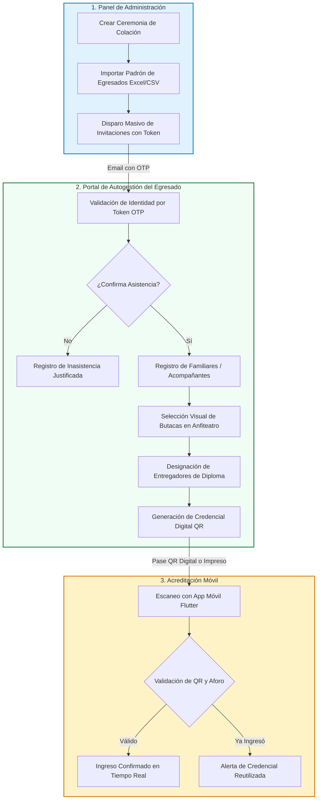

<p align="center">
  
</p>

<h1 align="center">SiGIC</h1>
<p align="center">
  <strong>Sistema de Gestión Institucional de Colaciones</strong><br>
  <em>Instituto Tecnológico Beltrán · Tecnicatura Superior en Analista de Sistemas (TSAS)</em><br>
  <strong>Práctica Profesionalizante III — Proyecto Final Integrador 2026</strong>
</p>

<p align="center">
  
  
  
  
  
  
</p>

<p align="center">
  <a href="https://gitlab.com/jcancelo-group1/sigic/-/pipelines"></a>
  &nbsp;
  
  &nbsp;
  
  &nbsp;
  
</p>

<p align="center">
  <a href="https://app.sigic.com.ar"><strong>🌐 Acceso a Producción Oficial: https://app.sigic.com.ar</strong></a> &nbsp;|&nbsp;
  <a href="https://www.sigic.com.ar">Sitio Institucional: www.sigic.com.ar</a>
</p>

> [!NOTE]
> **Estado de Despliegue en Vivo:** La plataforma web opera en infraestructura serverless en **Vercel** enlazada a un clúster PostgreSQL gestionado en **Neon Cloud** con cifrado forzado SSL/TLS (`sslmode=require`), garantizando disponibilidad continua para auditorías y mesas de evaluación académica.

---

## 📌 Descripción del Sistema

**SiGIC** es una solución integral diseñada para modernizar, automatizar y auditar integralmente el proceso de colación y entrega de diplomas en instituciones de educación superior. Cubre el ciclo de vida completo de cada ceremonia:

1. **Gestión Administrativa y Ceremonial**: Planificación de eventos, aforos, fechas límites, configuración de carreras y carga masiva de padrones desde planillas Excel/CSV.
2. **Autogestión del Graduado**: Acceso seguro sin contraseñas permanentes mediante códigos OTP enviados por correo electrónico, confirmación formal de asistencia, registro de acompañantes, selección visual interactiva de butacas en anfiteatro y designación de entregadores de diploma (docentes o familiares).
3. **Credencial Digital QR y Pase Grupal**: Generación de credenciales criptográficas con código QR que sirven como pase institucional de acceso grupal tanto en pantalla de smartphone como en formato A4 imprimible con lanyard.
4. **Acreditación Móvil en Tiempo Real**: Aplicación móvil en Flutter para personal de seguridad/portería con escaneo de alta velocidad, validación de ingresos y prevención de duplicidad de accesos fuera de línea y en línea.
5. **Centro de Control de Escritorio**: Aplicación nativa para Windows (`SiGIC.exe`) que orquesta el lanzamiento del servidor local Turbopack, acceso a la nube, documentación y recursos sin necesidad de dependencias externas.

---

## 🏛️ Estructura del Repositorio

El repositorio está estrictamente organizado respetando la arquitectura de capas y los estándares de ingeniería de software:

```text
SiGIC/
│
├── codigo/                           ★ CÓDIGO FUENTE DE LAS APLICACIONES
│   ├── plataforma/                   Plataforma Web principal (Next.js 16 + React 19 + Tailwind CSS 4)
│   ├── movil_flutter/                App móvil oficial de acreditación para portería (Flutter 3 + Dart)
│   ├── landing/                      Sitio web institucional de bienvenida y presentación (HTML5 / CSS3)
│   └── escritorio/                   Centro de Control y Evaluación nativo para Windows (Python / CustomTkinter)
│
├── docs/                             ★ DOCUMENTACIÓN TÉCNICA Y OPERATIVA
│   ├── MANUAL.md                     Manual exhaustivo de usuario (Administración, Egresados y Portería)
│   ├── ESQUEMA_BASE_DE_DATOS.md      Diagrama ER, diccionario de datos y script DDL de Neon PostgreSQL
│   ├── SEGURIDAD.md                  Políticas de autenticación, JWT, matriz de roles y rate limiting
│   ├── CONTEXTO_SIGIC.md             Ficha técnica, alcance y justificación del proyecto
│   ├── CHANGELOG.md                  Registro histórico de versiones y características añadidas
│   └── padron_modelo/                Planillas Excel (.xlsx) y CSV con el padrón modelo de egresados TSAS
│
├── herramientas/                     ★ UTILIDADES DE DESPLIEGUE Y CONTENEDORES
│   └── docker-compose.yml            Orquestación para despliegues locales contenerizados
│
├── SiGIC.exe                         ★ CENTRO DE CONTROL OFICIAL DE ESCRITORIO (Windows 64-bit)
└── README.md                         ★ Este documento
```

---

## 💻 Centro de Control de Escritorio (`SiGIC.exe`)

Para facilitar la evaluación por parte de la mesa examinadora y directivos sin requerir comandos de terminal, se desarrolló un **Centro de Control Nativo** compilado en 64 bits:

- **Estética Windows 11 Fluent Design**: Interfaz en Modo Claro con lienzo `#f1f5f9`, tarjetas blancas flotantes con bordes sutiles y tipografía oficial **Segoe UI**.
- **Identidad Beltrán**: Escudo oficial del Instituto Tecnológico Beltrán en alta resolución integrado en el encabezado.
- **Acceso Inmediato en Producción**: Botón directo para evaluar la versión en la nube activa en `app.sigic.com.ar`.
- **Servidor Local Turbopack Asistido**: Inicia y detiene el servidor Next.js en el puerto 3000 con un solo clic. Incorpora **detección y liberación automática de puertos**, cerrando procesos huérfanos de Node.js antes de iniciar.
- **Consola de Diagnóstico en Tiempo Real**: Terminal integrado con decodificación UTF-8 estricta, filtrado de códigos ANSI y visualización limpia de logs.
- **Accesos a Recursos**: Apertura inmediata del manual ilustrado en A4/HTML, la plantilla de importación Excel y la carpeta con el instalador APK para Android.

---

## 🛠️ Stack Tecnológico

| Capa | Tecnología | Características Clave |
|---|---|---|
| **Frontend Web** | React 19 + Next.js 16 (Turbopack) | Server Components, SPA orquestada por estado en `App.jsx`, renderizado ultrarrápido |
| **Estilos UI** | Tailwind CSS 4 + Lucide React | Diseño responsivo, Modo Claro institucional, tarjetas elevadas, sin dependencias pesadas |
| **Backend & API** | Next.js Serverless API Routes | Ruteador centralizado en `src/app/api/[...slug]/route.ts` con manejo transaccional |
| **Base de Datos** | Neon PostgreSQL (Serverless) | Conexión SSL (`sslmode=require`), pool nativo con `pg`, migraciones automáticas |
| **Autenticación** | JWT HS256 + Códigos OTP | Tokens criptográficos para administradores y tokens de un solo uso por email para egresados |
| **App Móvil** | Flutter 3 + Dart | Escáner QR de baja latencia con `mobile_scanner`, validación offline/online |
| **App de Escritorio** | Python 3.12 + CustomTkinter + PyInstaller | Binario nativo compilado de 22 MB sin dependencias de instalación |
| **Hosting & CI/CD** | Vercel + GitLab CI / GitHub Actions | Despliegue continuo con pruebas SAST de seguridad y compilación automatizada |

---

## 🚀 Flujo Operativo de la Plataforma



---

## 🔑 Cuentas y Credenciales de Demostración Oficiales

Para evaluar la plataforma en producción o localmente, se encuentran configuradas las siguientes cuentas:

| Rol | Correo Electrónico | Contraseña | Alcance de Permisos |
|---|---|---|---|
| **Super Administrador** | `admin@sigic.com.ar` | `admin123` | Gestión total de ceremonias, graduados, anfiteatro y reportes |
| **Soporte Institucional** | `soporte@sigic.com.ar` | `admin123` | Auditoría, mantenimiento, centro de control y base de datos |
| **Personal de Portería** | Acceso vía App Móvil | PIN de Sesión | Escaneo y validación de credenciales QR en los ingresos |
| **Panel del Expositor** | Widget flotante (esquina inferior derecha) | No requiere | Permite alternar perfiles (Graduado Invitado, Graduado Activo, Mantenimiento) |

---

## 📦 Puesta en Marcha en Entorno Local

### Opción A: Ejecución Inmediata con `SiGIC.exe` (Recomendada para Windows)
1. Haz doble clic en **`SiGIC.exe`** en la raíz del proyecto.
2. Pulsa en **"▶ Iniciar Servidor Local"**. El sistema verificará el entorno, liberará el puerto 3000 de procesos previos y abrirá automáticamente `http://localhost:3000` en tu navegador.

### Opción B: Ejecución Manual por Consola (Desarrollo)

**1. Plataforma Web:**
```bash
cd codigo/plataforma
npm install
npm run dev
```
La aplicación iniciará en `http://localhost:3000`.

**2. Aplicación Móvil (Portería):**
```bash
cd codigo/movil_flutter
flutter pub get
flutter run
```
*También puedes instalar directamente el APK oficial release ubicado en `docs/` o en el pendrive de entrega.*

---

## 📚 Documentación Técnica Detallada

| Documento | Ubicación | Descripción |
|---|---|---|
| **Manual de Usuario y Operativo** | [`docs/MANUAL.md`](docs/MANUAL.md) | Guía ilustrada paso a paso para Administradores, Egresados y Portería |
| **Diccionario y Esquema de Base de Datos** | [`docs/ESQUEMA_BASE_DE_DATOS.md`](docs/ESQUEMA_BASE_DE_DATOS.md) | Diagrama Entidad-Relación y definición de tablas PostgreSQL |
| **Arquitectura de Seguridad** | [`docs/SEGURIDAD.md`](docs/SEGURIDAD.md) | Políticas de tokens JWT HS256, OTP, roles y rate limiting |
| **Ficha Técnica y Alcance** | [`docs/CONTEXTO_SIGIC.md`](docs/CONTEXTO_SIGIC.md) | Justificación institucional, objetivos y alcance del sistema |
| **Historial de Versiones** | [`docs/CHANGELOG.md`](docs/CHANGELOG.md) | Evolución cronológica de versiones y correcciones |
| **Padrón de Graduados Modelo** | [`docs/padron_modelo/`](docs/padron_modelo/) | Archivos Excel (`.xlsx`) y CSV de muestra para importaciones masivas |

---

## 👥 Equipo de Desarrollo

Proyecto desarrollado y defendido en el marco de la **Práctica Profesionalizante III** de la carrera **Tecnicatura Superior en Analista de Sistemas** en el **Instituto Tecnológico Beltrán**:

<table>
  <tr>
    <td align="center">
      <br />
      <sub><b>Cancelo Julian</b></sub><br />
      <small>Líder de Proyecto & Fullstack · Analista de Sistemas</small>
    </td>
    <td align="center">
      <br />
      <sub><b>Alfonso Alan Alexis</b></sub><br />
      <small>Analista de Sistemas</small>
    </td>
    <td align="center">
      <br />
      <sub><b>Contreras V. Sol</b></sub><br />
      <small>Analista de Sistemas</small>
    </td>
    <td align="center">
      <br />
      <sub><b>Frassia Matias</b></sub><br />
      <small>Analista de Sistemas</small>
    </td>
    <td align="center">
      <br />
      <sub><b>Santillan Luis G.</b></sub><br />
      <small>Analista de Sistemas</small>
    </td>
  </tr>
</table>

<br>

<p align="center">
  <strong>Instituto Tecnológico Beltrán</strong><br>
  Av. Belgrano 1191, Avellaneda, Provincia de Buenos Aires, Argentina<br>
  <em>Ciclo Lectivo 2026</em>
</p>
