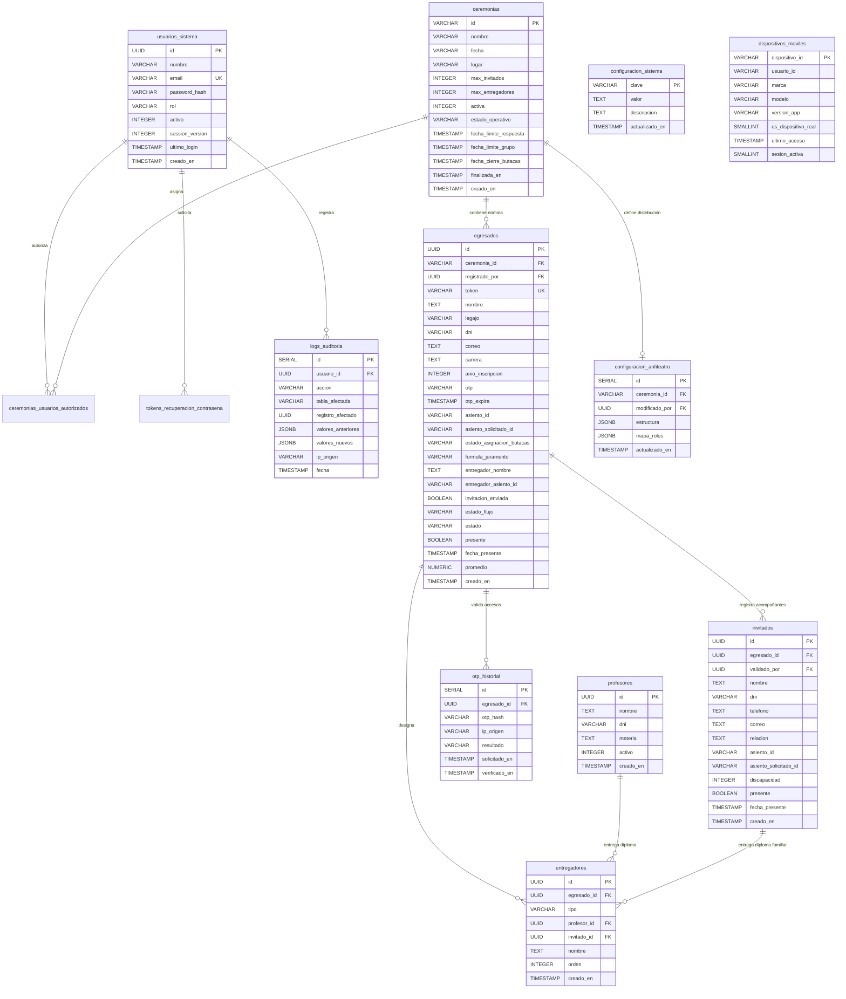

# SiGIC — Modelo de Datos y Esquema Relacional de Base de Datos

> **Sistema de Gestión Institucional de Colaciones**  
> **Motor de Base de Datos**: PostgreSQL 16 (Neon Serverless Cloud)  
> **Driver**: Pool de conexiones nativo `pg` (Node.js) con SSL forzado  
> **Codificación**: UTF-8 | Tipado estricto con UUID v4 (`uuid-ossp`)

---

## 1. Diagrama de Entidad-Relación (Mermaid)



---

## 2. Diccionario de Datos de Tablas Principales

### 2.1. `ceremonias` (Eventos Institucionales de Colación)
Representa cada acto académico programado. Permite la coexistencia de ceremonias históricas archivadas y una ceremonia activa.

| Columna | Tipo | Restricciones | Descripción |
|---|---|---|---|
| `id` | `VARCHAR(50)` | `PRIMARY KEY` | Identificador único (ej: `cer-1792191251564`) |
| `nombre` | `VARCHAR(150)` | `NOT NULL` | Denominación del acto (ej: *"Colación Promoción 2026"*) |
| `fecha` | `VARCHAR(50)` | `NOT NULL` | Fecha y hora de realización del evento |
| `lugar` | `VARCHAR(150)` | Valor por defecto `'Sede Beltrán'` | Ubicación física o auditorio |
| `max_invitados` | `INTEGER` | Default `4` | Cupo máximo de acompañantes por egresado |
| `max_entregadores` | `INTEGER` | Default `3` | Límite de personas autorizadas a entregar el diploma |
| `activa` | `INTEGER` | Default `0` (`INDEX UNIQUE` condicional para `activa = 1`) | Bandera de entorno activo del sistema |
| `estado_operativo` | `VARCHAR(24)` | Default `'BORRADOR'` | Estados: `BORRADOR`, `CONVOCATORIA`, `SEATING`, `EN_CURSO`, `FINALIZADA` |
| `fecha_limite_respuesta` | `TIMESTAMP` | Opcional | Plazo límite para confirmación o rechazo de asistencia |
| `fecha_limite_grupo` | `TIMESTAMP` | Opcional | Fecha límite para registrar acompañantes |
| `fecha_cierre_butacas` | `TIMESTAMP` | Opcional | Cierre de edición de asignación de asientos |
| `finalizada_en` | `TIMESTAMP` | Opcional | Fecha y hora en que se concluyó y archivó el acto |

---

### 2.2. `egresados` (Padrón Oficial de Graduados)
Almacena la nómina de graduados, sus credenciales dinámicas, estado de juramento y asignación de asiento.

| Columna | Tipo | Restricciones | Descripción |
|---|---|---|---|
| `id` | `UUID` | `PRIMARY KEY (uuid_generate_v4())` | Identificador único universal |
| `ceremonia_id` | `VARCHAR(50)` | `REFERENCES ceremonias(id) ON DELETE CASCADE` | Ceremonia a la cual pertenece |
| `token` | `VARCHAR(10)` | `UNIQUE NOT NULL` | Token seguro de acceso al portal sin usuario/clave |
| `nombre` | `TEXT` | `NOT NULL` | Nombre y apellido completo |
| `legajo` | `VARCHAR(50)` | `NOT NULL` | Número de legajo académico |
| `dni` | `VARCHAR(20)` | `NOT NULL` | Documento Nacional de Identidad |
| `correo` | `TEXT` | `NULLABLE` | Correo electrónico institucional / personal |
| `carrera` | `TEXT` | `NULLABLE` | Carrera de egreso |
| `asiento_id` | `VARCHAR(30)` | `NULLABLE` | Código de butaca asignada en el anfiteatro (ej: `PB-A-12`) |
| `formula_juramento` | `VARCHAR(40)` | `NULLABLE` | Fórmula protocolar (`DIOS_Y_PATRIA` o `PATRIA`) |
| `estado` | `VARCHAR(20)` | Default `'PENDIENTE'` (`CHECK ('PENDIENTE','ACEPTADO','RECHAZADO')`) | Estado de respuesta del graduado |
| `estado_flujo` | `VARCHAR(30)` | Default `'SIN_INVITAR'` | Etapas: `SIN_INVITAR`, `INVITADO`, `CONFIRMADO`, `CRED_LISTA` |
| `presente` | `BOOLEAN` | Default `FALSE` | Registro de ingreso validado por portería en tiempo real |
| `fecha_presente` | `TIMESTAMP` | `NULLABLE` | Marca de tiempo exacta del escaneo en puerta |
| `promedio` | `NUMERIC(5,2)` | `NULLABLE` | Promedio general de la carrera |

---

### 2.3. `invitados` (Acompañantes y Padrinos)
Registra cada uno de los asistentes que concurren vinculados a un graduado.

| Columna | Tipo | Restricciones | Descripción |
|---|---|---|---|
| `id` | `UUID` | `PRIMARY KEY (uuid_generate_v4())` | Identificador único universal |
| `egresado_id` | `UUID` | `REFERENCES egresados(id) ON DELETE CASCADE` | Egresado que lo invitó |
| `nombre` | `TEXT` | `NOT NULL` | Nombre completo del invitado |
| `dni` | `VARCHAR(20)` | `NOT NULL` | DNI (único por egresado: `UNIQUE(dni, egresado_id)`) |
| `relacion` | `TEXT` | `NULLABLE` | Vínculo familiar (Madre, Padre, Cónyuge, etc.) |
| `asiento_id` | `VARCHAR(30)` | `NULLABLE` | Butaca asignada en el sector de invitados |
| `discapacidad` | `INTEGER` | Default `0` | Indicador de movilidad reducida (prioridad planta baja) |
| `presente` | `BOOLEAN` | Default `FALSE` | Acreditación validada por portería |
| `fecha_presente` | `TIMESTAMP` | `NULLABLE` | Fecha y hora de ingreso al auditorio |

---

### 2.4. `profesores` (Plantel Docente para Entrega de Diplomas)
Docentes registrados en la institución disponibles para ser seleccionados por los graduados como entregadores de título.

| Columna | Tipo | Restricciones | Descripción |
|---|---|---|---|
| `id` | `UUID` | `PRIMARY KEY (uuid_generate_v4())` | Identificador único |
| `nombre` | `TEXT` | `NOT NULL` | Nombre y título profesional del docente |
| `dni` | `VARCHAR(20)` | `NULLABLE` | Documento de identidad |
| `materia` | `TEXT` | `NULLABLE` | Cátedra o departamento académico |
| `activo` | `INTEGER` | Default `1` | Docente en funciones disponible para selección |

---

### 2.5. `entregadores` (Relación de Entrega Protocolar)
Vincula a cada egresado con la persona (docente o familiar) que le entregará el diploma sobre el escenario.

| Columna | Tipo | Restricciones | Descripción |
|---|---|---|---|
| `id` | `UUID` | `PRIMARY KEY (uuid_generate_v4())` | Identificador único |
| `egresado_id` | `UUID` | `REFERENCES egresados(id) ON DELETE CASCADE` | Graduado que recibe el diploma |
| `tipo` | `VARCHAR(20)` | `CHECK (tipo IN ('PROFESOR','FAMILIAR'))` | Tipo de entregador |
| `profesor_id` | `UUID` | `REFERENCES profesores(id) ON DELETE SET NULL` | ID del profesor (si es tipo `PROFESOR`) |
| `invitado_id` | `UUID` | `REFERENCES invitados(id) ON DELETE SET NULL` | ID del invitado (si es tipo `FAMILIAR`) |
| `orden` | `INTEGER` | Default `1` (`UNIQUE(egresado_id, orden)`) | Orden de prioridad de entrega |

---

### 2.6. `configuracion_anfiteatro` (Mapa y Butacas del Auditorio)
Almacena el plano interactivo de la sala, sectores y reglas de auto-asignación por ceremonia.

| Columna | Tipo | Restricciones | Descripción |
|---|---|---|---|
| `id` | `SERIAL` | `PRIMARY KEY` | Autoincremental |
| `ceremonia_id` | `VARCHAR(50)` | `REFERENCES ceremonias(id) ON DELETE CASCADE` | Ceremonia a la cual pertenece el plano |
| `estructura` | `JSONB` | `NOT NULL` | Definición de filas, bloques, columnas y pasillos |
| `mapa_roles` | `JSONB` | `NOT NULL` | Asignación de roles por asiento (`egresado`, `invitado`, `profesor`, `autoridad`, `bloqueado`) |

---

### 2.7. `usuarios_sistema` (Cuentas de Administración y Portería)
Gestiona el acceso de los operadores del sistema con control de sesiones y roles.

| Columna | Tipo | Restricciones | Descripción |
|---|---|---|---|
| `id` | `UUID` | `PRIMARY KEY (uuid_generate_v4())` | Identificador único |
| `nombre` | `VARCHAR(100)` | `NOT NULL` | Nombre del usuario |
| `email` | `VARCHAR(150)` | `UNIQUE NOT NULL` | Correo de inicio de sesión |
| `password_hash` | `VARCHAR(255)` | `NOT NULL` | Hash de contraseña con salt |
| `rol` | `VARCHAR(20)` | `CHECK (rol IN ('ADMINISTRATIVO','PORTERIA'))` | Nivel de autorización |
| `session_version` | `INTEGER` | Default `1` | Control de revocación global de JWT |
| `activo` | `INTEGER` | Default `1` | Habilitación de la cuenta |

---

## 3. Script SQL DDL de Generación Completa

Para desplegar o recrear el esquema completo en cualquier instancia PostgreSQL limpia:

```sql
-- Extensión requerida para claves UUID
CREATE EXTENSION IF NOT EXISTS "uuid-ossp";

-- 1. Usuarios del Sistema
CREATE TABLE IF NOT EXISTS usuarios_sistema (
  id UUID PRIMARY KEY DEFAULT uuid_generate_v4(),
  nombre VARCHAR(100) NOT NULL,
  email VARCHAR(150) NOT NULL UNIQUE,
  password_hash VARCHAR(255) NOT NULL,
  rol VARCHAR(20) NOT NULL CHECK (rol IN ('ADMINISTRATIVO','PORTERIA')),
  activo INTEGER DEFAULT 1,
  session_version INTEGER NOT NULL DEFAULT 1,
  ultimo_login TIMESTAMP,
  creado_en TIMESTAMP DEFAULT CURRENT_TIMESTAMP
);

-- 2. Ceremonias de Colación
CREATE TABLE IF NOT EXISTS ceremonias (
  id VARCHAR(50) PRIMARY KEY,
  nombre VARCHAR(150) NOT NULL,
  fecha VARCHAR(50) NOT NULL,
  lugar VARCHAR(150) DEFAULT 'Sede Beltrán',
  max_invitados INTEGER DEFAULT 4,
  max_entregadores INTEGER DEFAULT 3,
  activa INTEGER DEFAULT 0,
  estado_operativo VARCHAR(24) NOT NULL DEFAULT 'BORRADOR',
  finalizada_en TIMESTAMP,
  fecha_limite_respuesta TIMESTAMP,
  fecha_limite_grupo TIMESTAMP,
  fecha_cierre_butacas TIMESTAMP,
  creado_en TIMESTAMP DEFAULT CURRENT_TIMESTAMP
);

-- Garantiza una sola ceremonia activa en simultáneo
CREATE UNIQUE INDEX IF NOT EXISTS ceremonias_una_activa
  ON ceremonias ((activa)) WHERE activa = 1;

-- 3. Profesores y Padrinos
CREATE TABLE IF NOT EXISTS profesores (
  id UUID PRIMARY KEY DEFAULT uuid_generate_v4(),
  nombre TEXT NOT NULL,
  dni VARCHAR(20),
  materia TEXT,
  activo INTEGER DEFAULT 1,
  creado_en TIMESTAMP DEFAULT CURRENT_TIMESTAMP
);

-- 4. Padrón de Egresados
CREATE TABLE IF NOT EXISTS egresados (
  id UUID PRIMARY KEY DEFAULT uuid_generate_v4(),
  ceremonia_id VARCHAR(50) REFERENCES ceremonias(id) ON DELETE CASCADE,
  registrado_por UUID REFERENCES usuarios_sistema(id) ON DELETE SET NULL,
  token VARCHAR(10) NOT NULL UNIQUE,
  nombre TEXT NOT NULL,
  legajo VARCHAR(50) NOT NULL,
  dni VARCHAR(20) NOT NULL,
  correo TEXT,
  carrera TEXT,
  anio_inscripcion INTEGER,
  otp VARCHAR(6),
  otp_expira TIMESTAMP,
  asiento_id VARCHAR(30),
  asiento_solicitado_id VARCHAR(30),
  estado_asignacion_butacas VARCHAR(30) NOT NULL DEFAULT 'SIN_SOLICITUD',
  formula_juramento VARCHAR(40),
  entregador_nombre TEXT,
  entregador_asiento_id VARCHAR(30),
  telefono TEXT,
  invitacion_enviada BOOLEAN DEFAULT FALSE,
  invitacion_ultimo_envio_en TIMESTAMP,
  invitacion_envios_count INTEGER NOT NULL DEFAULT 0,
  credencial_enviada_en TIMESTAMP,
  credencial_envios_count INTEGER NOT NULL DEFAULT 0,
  google_wallet_object_id VARCHAR(180),
  google_wallet_actualizado_en TIMESTAMP,
  identidad_corrobada_en TIMESTAMP,
  estado_flujo VARCHAR(30) DEFAULT 'SIN_INVITAR',
  perfil_finalizado_en TIMESTAMP,
  aviso_edicion_enviado_en TIMESTAMP,
  edicion_habilitada_hasta TIMESTAMP,
  edicion_habilitada_motivo TEXT,
  estado VARCHAR(20) DEFAULT 'PENDIENTE' CHECK (estado IN ('PENDIENTE','ACEPTADO','RECHAZADO')),
  presente BOOLEAN DEFAULT FALSE,
  fecha_presente TIMESTAMP,
  promedio NUMERIC(5,2),
  creado_en TIMESTAMP DEFAULT CURRENT_TIMESTAMP
);

-- 5. Invitados / Acompañantes
CREATE TABLE IF NOT EXISTS invitados (
  id UUID PRIMARY KEY DEFAULT uuid_generate_v4(),
  egresado_id UUID NOT NULL REFERENCES egresados(id) ON DELETE CASCADE,
  validado_por UUID REFERENCES usuarios_sistema(id) ON DELETE SET NULL,
  nombre TEXT NOT NULL,
  dni VARCHAR(20) NOT NULL,
  telefono TEXT,
  correo TEXT,
  relacion TEXT,
  asiento_id VARCHAR(30),
  asiento_solicitado_id VARCHAR(30),
  discapacidad INTEGER DEFAULT 0,
  presente BOOLEAN DEFAULT FALSE,
  fecha_presente TIMESTAMP,
  creado_en TIMESTAMP DEFAULT CURRENT_TIMESTAMP,
  UNIQUE (dni, egresado_id)
);

-- 6. Entregadores de Título
CREATE TABLE IF NOT EXISTS entregadores (
  id UUID PRIMARY KEY DEFAULT uuid_generate_v4(),
  egresado_id UUID NOT NULL REFERENCES egresados(id) ON DELETE CASCADE,
  tipo VARCHAR(20) NOT NULL CHECK (tipo IN ('PROFESOR','FAMILIAR')),
  profesor_id UUID REFERENCES profesores(id) ON DELETE SET NULL,
  invitado_id UUID REFERENCES invitados(id) ON DELETE SET NULL,
  nombre TEXT NOT NULL,
  orden INTEGER NOT NULL DEFAULT 1,
  creado_en TIMESTAMP DEFAULT CURRENT_TIMESTAMP,
  UNIQUE (egresado_id, orden)
);

-- 7. Configuración de Butacas y Sala
CREATE TABLE IF NOT EXISTS configuracion_anfiteatro (
  id SERIAL PRIMARY KEY,
  ceremonia_id VARCHAR(50) REFERENCES ceremonias(id) ON DELETE CASCADE,
  modificado_por UUID REFERENCES usuarios_sistema(id) ON DELETE SET NULL,
  estructura JSONB NOT NULL,
  mapa_roles JSONB NOT NULL,
  actualizado_en TIMESTAMP DEFAULT CURRENT_TIMESTAMP
);

-- 8. Ajustes Globales del Sistema
CREATE TABLE IF NOT EXISTS configuracion_sistema (
  clave VARCHAR(100) PRIMARY KEY,
  valor TEXT NOT NULL,
  descripcion TEXT,
  actualizado_en TIMESTAMP DEFAULT CURRENT_TIMESTAMP
);

-- 9. Historial OTP de Acceso
CREATE TABLE IF NOT EXISTS otp_historial (
  id SERIAL PRIMARY KEY,
  egresado_id UUID NOT NULL REFERENCES egresados(id) ON DELETE CASCADE,
  otp_hash VARCHAR(64) NOT NULL,
  ip_origen VARCHAR(120),
  resultado VARCHAR(32) NOT NULL,
  solicitado_en TIMESTAMP DEFAULT CURRENT_TIMESTAMP,
  verificado_en TIMESTAMP
);

-- 10. Auditoría de Seguridad
CREATE TABLE IF NOT EXISTS logs_auditoria (
  id SERIAL PRIMARY KEY,
  usuario_id UUID REFERENCES usuarios_sistema(id) ON DELETE SET NULL,
  accion VARCHAR(50) NOT NULL,
  tabla_afectada VARCHAR(50),
  registro_afectado UUID,
  valores_anteriores JSONB,
  valores_nuevos JSONB,
  ip_origen VARCHAR(120),
  fecha TIMESTAMP DEFAULT CURRENT_TIMESTAMP
);

-- 11. Dispositivos Móviles de Portería
CREATE TABLE IF NOT EXISTS dispositivos_moviles (
  dispositivo_id VARCHAR(100) PRIMARY KEY,
  usuario_id VARCHAR(100) NOT NULL,
  marca VARCHAR(100),
  modelo VARCHAR(160),
  version_app VARCHAR(40),
  es_dispositivo_real SMALLINT DEFAULT 1,
  ultimo_acceso TIMESTAMP DEFAULT CURRENT_TIMESTAMP,
  sesion_activa SMALLINT DEFAULT 1
);

-- Índices de Rendimiento Operativo
CREATE INDEX IF NOT EXISTS idx_egresados_token ON egresados(token);
CREATE INDEX IF NOT EXISTS idx_egresados_dni ON egresados(dni);
CREATE INDEX IF NOT EXISTS idx_egresados_correo ON egresados(correo);
CREATE INDEX IF NOT EXISTS idx_egresados_ceremonia ON egresados(ceremonia_id);
CREATE INDEX IF NOT EXISTS idx_invitados_egresado ON invitados(egresado_id);
CREATE INDEX IF NOT EXISTS idx_invitados_presente ON invitados(presente);
CREATE INDEX IF NOT EXISTS idx_entregadores_egresado ON entregadores(egresado_id);
```
